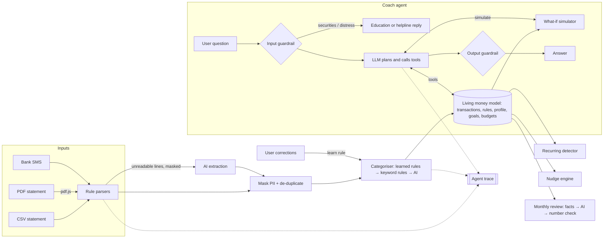

# Hisaab: an agentic personal finance coach with a living money model

*Product Space Agentic AI Hackathon '26, problem statement 04: "Personal finance coach with a living money model".*

**Try it, no login:** https://ananya2104.github.io/hisaab/ (click **Watch a recorded AI session**) · **Live AI version:** https://claude.ai/artifact/4ctbhB5aCAENGaH8LZbTPA (needs a Claude login) · **Demo video:** [add your video link here]

Most budgeting apps sort transactions into categories and stop there. Hisaab keeps a *living* model of your money. It reads messy Indian bank data (statement CSVs, PDFs, bank SMS), learns from every correction you make, spots subscriptions and price hikes, plans goals with what-if scenarios, nudges you when spending drifts, and writes a monthly review. An AI agent sits on top. It decides which tools to use, takes low-risk actions on its own, and shows every step in a live trace. It educates and models scenarios. It never recommends specific securities.

**The twist, Future You:** most finance apps show charts. Hisaab lets you *meet yourself in five years*. Two future selves, "Drift you" (this month's habits become normal) and "Plan you" (you stick to the plan), are projected by code from your real transactions. They write you a letter, speak in their own voices, and answer your questions in character.

---

## 1. The problem

| | |
|---|---|
| **User** | Young salaried professionals in Indian metros (22–32), in their first or second job. Their money moves through UPI, cards and auto-debits across several apps, and they carry 3–6 subscriptions they rarely review. |
| **Why this segment** | They have a regular income and enough transactions for patterns to matter, and they are digital-first: they already get bank SMS for every payment. Their main risk is drift (food delivery, subscriptions, lifestyle creep), not complex products. |
| **Pain today** | Data is scattered and messy: PDFs, CSVs in different layouts, and SMS in a dozen bank formats. Budgeting apps need manual tagging, forget corrections, and don't answer "can I still afford the trip if rent goes up?" |
| **Goal for the product** | Turn scattered transactions into a model that stays current, and drive one behaviour: noticing and correcting drift before the month ends. |

## 2. The twist: Future You

**Why:** people under-save partly because their future self feels like a stranger. In a Stanford study, people who interacted with age-progressed images of themselves were more willing to choose later money over immediate rewards ([Hershfield et al., 2011, *Journal of Marketing Research*](https://vhil.stanford.edu/publications/increasing-saving-behavior-through-age-progressed-renderings-future-self)). Budget warnings are easy to dismiss; a conversation with yourself is not.

**How it works:**

1. **Code projects two futures five years out**, month by month, from the living money model.
   - *Drift you:* any habit spending this month at a faster pace than usual (food delivery here) becomes the new normal, and unused subscriptions keep running.
   - *Plan you:* your What-if settings, or a starter plan (food delivery −30%, dining out −20%, cancel subscriptions marked unused).
   - Both futures assume income +7% and costs +5% a year, SIPs continuing, and **no investment returns** (no market predictions).
   - Goals are funded in deadline order. The projection shows money built up, the month each goal is reached, and five-year totals for food delivery and subscriptions.
2. **The AI writes a short letter from each self**, using only numbers from the projection. Code then checks every ₹ and % against the projection and highlights anything that isn't there.
3. **Each self speaks in its own Claude voice**, and you can play both as a short dialogue.
4. **Ask your future self:** type or speak a question ("Did we make the Goa trip?"). An agent answers in character, calling `get_future_projection` and `simulate_what_if`, so "what if I also cut shopping?" gets a real recalculation. Tone rules: warm and honest, never shaming or frightening, no securities.

On the demo account, Plan Priya has built about ₹7 lakh more than Drift Priya by November 2031, and spent about ₹6 lakh less on food delivery along the way.

## 3. What it does (mapped to the brief)

| Brief requirement | How Hisaab does it |
|---|---|
| Ingest bank statements in messy formats (PDF, CSV, SMS) with automatic categorisation | Rules parse common Indian formats: HDFC-style CSV with junk header rows, and UPI, card, NEFT, ACH, ATM and BBPS SMS. OTPs and promotional SMS are dropped. Unknown CSV layouts and unreadable lines go to the model, after masking. Categories come from learned rules, then keyword rules, then AI for unknown payees. |
| Correction loop that learns rules | Change a category, and Hisaab offers to learn a rule ("payee contains RAMESH KUMAR → Rent"). The rule re-categorises past transactions and applies to every future import. The agent can also add rules. |
| Recurring payments and subscriptions, with alerts when one changes or goes unused | Detected from timing and amount patterns. Alerts cover price changes (Netflix ₹649 → ₹799), overlapping apps (three video-streaming apps), missed payments, and unused subscriptions. Bank data can't see usage, so the agent asks the user and adds unused ones to a cancel list with the yearly saving. |
| Persistent financial profile: income, fixed costs, emergency fund, goals with dates | Income detected from salary credits; fixed and essential costs from categories; an emergency fund target in months of essentials; goals with target dates. Saved to the user's Claude account (or browser storage when run standalone). |
| Goal planner with what-if simulation | Sliders, or plain-language questions to the agent ("what if my rent goes up by ₹3,000?"). Code does the maths: new surplus, savings rate, extra per year, and the month each goal is reached before and after. |
| Nudges when spending drifts off plan | Month-to-date spending is compared with the budget at today's pace, and the month-end total is projected. Goal slippage, a low emergency fund and subscription alerts also become nudges. The agent can add its own. |
| Monthly review report | Code computes the facts, the AI writes the narrative, and code then checks that every ₹ and % in the narrative exists in the facts. Unverified figures are highlighted. |
| Clear guardrails: no specific securities | A hard input filter blocks requests for stock, fund or crypto picks and answers with education instead. Instructions to the agent repeat the rule, and an output filter strips any specific security that slips through. All three are logged in the trace. |

## 4. Where AI is used, and where it deliberately isn't

| Job | Done by | Why |
|---|---|---|
| Parsing known bank formats | Rules | Fast, free, exact |
| Parsing unknown layouts and messy lines | AI | Unstructured text; personal data masked first |
| Categorising known merchants | Keyword rules plus your learned rules | Deterministic, and improves with corrections |
| Categorising unknown payees (e.g. a person paid ₹22,000 on the 3rd of every month) | AI | Needs judgement from amount and timing patterns |
| Subscriptions, budgets, nudges, what-if maths, goal dates | Code | Numbers must be exact and repeatable |
| Answering open questions, planning multi-step work, acting | AI agent with tools | Open-ended, multi-step |
| Monthly review narrative | AI, then a code check | Readable story, with every figure verified |
| Future You projection | Code | Five years of numbers must be exact and explainable |
| Future-self letters, voices and conversation | AI agent, then a code check | Emotional, personal framing grounded in the projection |

On the demo data, rules handle about 92% of transactions (188 of 203). The model sees only the 15 the rules can't place, so cost and latency stay low.

## 5. Agent design

There are four agentic loops. Each step appears live in the **Agent trace** panel (PLAN, TOOL, RESULT, ACTION, GUARDRAIL, ANSWER).

1. **Import agent (runs on its own on every upload):** plan → parse with rules → send unreadable lines to the model → mask personal data → de-duplicate against history → categorise (learned rules → keyword rules → model) → rebuild the money model → raise nudges.
2. **Coach agent (tool-using LLM loop):** the model reads the question, decides which of 10 tools to call, calls them (possibly several times), and answers using only numbers returned by tools. It may take low-risk actions on its own and says what it did. "Run autonomous check-up" asks it to review the month, check subscriptions and goals, then create nudges and fix unrealistic budgets without further input.
3. **Review agent:** code computes facts → model writes → code verifies each figure.
4. **Future-self agent:** speaks as Drift or Plan you, calls `get_future_projection` and `simulate_what_if`, and answers in character; letters are figure-checked and can be read aloud.

### Tools the coach can use

| Tool | Type | What it does |
|---|---|---|
| `get_overview` | read | Income, spend, surplus, savings rate, emergency fund, goals, top categories |
| `category_summary` | read | One month by category against the average and budget |
| `query_transactions` | read | Filter by month, category, payee or amount |
| `list_recurring` | read | Recurring payments with alerts |
| `simulate_what_if` | compute | Runs a scenario in code: category cuts, rent or income changes, cancelled subscriptions |
| `set_budget` | action | Sets a category budget |
| `add_goal` | action | Creates or updates a goal |
| `create_nudge` | action | Adds a nudge to the home screen |
| `add_category_rule` | action | Teaches a categorisation rule |
| `mark_subscription` | action | Records "unused" or "keep" for a subscription |
| `get_future_projection` | read | Five-year projection for the drift or plan self (Future You chat) |

The agent can add and change things, but no tool can delete data.

### Architecture

## 6. Guardrails and responsible AI

- **No securities advice:** input filter, agent instructions and output filter. Users get general education (emergency fund first, diversification, costs, time horizon) and a pointer to a SEBI-registered investment adviser.
- **No made-up numbers:** every figure in an answer comes from a tool. The review's ₹ and % figures are checked against computed facts.
- **Privacy:** account numbers, phone numbers, UPI IDs and reference numbers are masked before any text reaches the model. Only the payees the rules can't place are sent for categorisation.
- **Distress:** messages showing financial distress or self-harm intent get a supportive reply and India's Tele-MANAS helpline (14416), not finance advice.
- **Bounded autonomy:** the agent acts only through listed tools, never deletes data, and stops after 8 tool rounds.

## 7. How we'd measure success

| Metric | Why it matters |
|---|---|
| Share of transactions categorised without user correction | Core accuracy of the money model |
| Corrections per 100 transactions, month over month | Should fall as learned rules accumulate |
| Share of lines parsed by rules rather than AI | Cost and latency control |
| Nudge action rate (budget changed, subscription cancelled, spend slowed) | Did the product change behaviour? |
| Monthly review figure-check pass rate | Hallucination control |
| Guardrail precision (blocked questions that really asked for picks) | Safety without over-blocking |
| Agent latency and model calls per user per month | Unit economics |

## 8. Running it

**Inside Claude:** open the shared link and click **Load demo data**. AI runs through the viewer's Claude account, and data is saved privately to their account.

**Public copy, no login (GitHub Pages):** https://ananya2104.github.io/hisaab/. Without a Claude login the AI is off, so this copy offers a **recorded session**: a file exported from a real run with Claude (`replay/session.json`). It replays the AI answers, future-self letters, the autonomous check-up and the monthly review, clearly labelled as recorded. The live agent trace for that run is shown in the demo video. One repeated check-up from the end of the run was trimmed from the file, because it exposed a bug that has since been fixed (a blocked stock question leaked into the next prompt). Everything that isn't AI (parsing, rules, subscriptions, what-if, projections) runs live in the browser.

**On your own machine:** open `index.html` in Chrome. Everything except the AI parts works offline in rules-only mode. To turn on the agent, open **Settings** and add an Anthropic API key. It is stored only in your browser and sent only to `api.anthropic.com`.

**Tests:** `bash tests/run_headless.sh` runs an end-to-end scenario in headless Chrome with a fake Claude runtime. It imports both demo files, checks categories, recurring payments, nudges, goals, what-if, rule learning, the guardrail, the agent's tool calls, the review number check, Future You projections, letter figure checks, the future-self chat and saving.

**Sample data:** `sample_data/` holds a 3-month HDFC-style statement CSV (Aug–Oct 2026) and 46 bank SMS for 1–20 Nov 2026, including OTPs, offers and two messy formats. `tools/gen_sample_data.py` regenerates them; `tools/build.py` rebuilds `index.html` from `tools/src.html`.

## 9. Limitations and next steps

- PDF import works for text-based statements; scanned PDFs need OCR.
- Bank data can't show whether a subscription is used, so the agent asks the user.
- Single user. Next: RBI's Account Aggregator framework for consented, automatic statement fetching; a WhatsApp interface; Hindi and regional languages.
- Goal planning uses simple deadline-first funding, with no returns assumed.
- Future You uses fixed growth assumptions (income +7%, costs +5% a year); next step is letting users edit them, and an age-progressed portrait.

## 10. Who built what

Hisaab was built during the hackathon on 21 November 2026, as the rules require.

- **AI-generated:** the application code, sample data, tests and the first draft of this README were generated with Claude (Anthropic) under my direction.
- **My contribution:** I chose problem 04 and the Future You idea, directed the features and reviewed each version, tested the app end to end with live AI, set up the GitHub repository and the public site, and recorded and narrated the demo video (Claude edited it: cuts, captions and zooms).

## Tech

A single-file HTML/CSS/JavaScript app with no framework or build step. It uses pdf.js (cdnjs) for PDF text. AI runs through the Claude artifact runtime (`sample` with tools, `db` for per-user storage, `tts` for the future selves' voices, `dictation` for spoken questions) or, when standalone, through the Anthropic Messages API with tool use.
